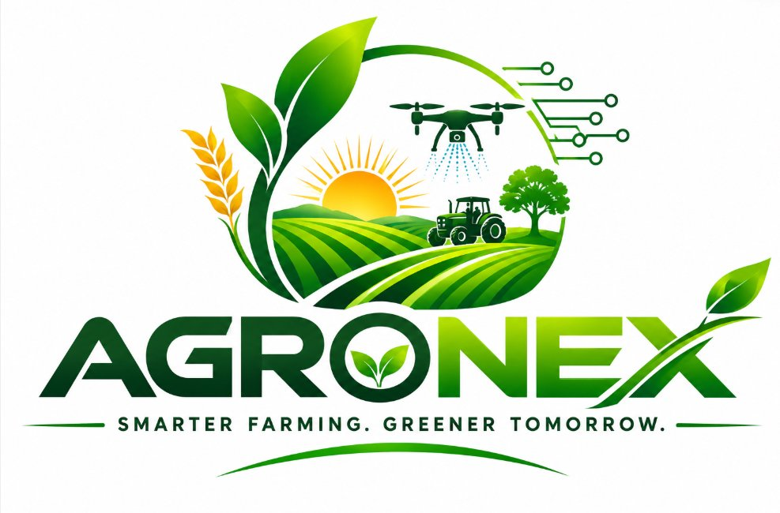

# 🌾 AGRONEX AI PRO – Next-Generation Smart Agriculture Ecosystem

<div align="center">



### **"Smarter Farming • Greener Tomorrow"**

[](https://react.dev/)
[](https://www.typescriptlang.org/)
[](https://tailwindcss.com/)
[](https://vitejs.dev/)
[](https://lucide.dev/)
[](https://onemilliononebillion.org/)

**Official Repository:** [https://github.com/Rohith-1301/Agronex-Farming](https://github.com/Rohith-1301/Agronex-Farming)  
**Author:** Rohith S • **Mentor:** Paramjeet (`paramjeet@onemoneb.org`)  
**Program:** 1M1B Green Internship / Youth Impact & Readiness Program (YIRP)

</div>

---

## 📖 Executive Summary

**AGRONEX AI PRO** is an intelligent, full-stack precision agriculture and farm management web platform engineered specifically for Indian farmers and agronomists. Focused heavily on high-accuracy agronomic telemetry, multilingual accessibility, and regional soil-climate dynamics (specifically calibrated for Tamil Nadu & Indian agro-climatic zones), AGRONEX empowers farmers to shift from reactive practices to proactive, data-driven agriculture.

The platform is structured into **six core production modules** seamlessly integrated through a reactive state architecture:

1. **Farmer Profile & Smart Farm Dashboard** (Multi-field management & live telemetry)
2. **AI-Based Precision Crop Selection & Growth Timeline** (Rotation-aware & soil-pH matched)
3. **AI Crop Doctor & Clinical Pathology Prescription** (ICAR/TNAU clinical treatments)
4. **Multilingual AGRI AI Assistant** (Voice-enabled farming copilot in 5 Indian languages)
5. **Government Agriculture Schemes & Application Portal** (20 verified schemes with AI matcher)
6. **AI Farm Profit & Loss Calculation** (Dynamic agro-financial ledgers & MSP forecasting)

---

## 🏛️ Platform Architecture & 6 Core Modules

```
                           ┌────────────────────────────┐
                           │      AGRONEX AI PRO        │
                           │     Unified React App      │
                           └─────────────┬──────────────┘
                                         │
     ┌───────────────┬───────────────────┼───────────────────┬───────────────┐
     │               │                   │                   │               │
┌────▼────┐    ┌─────▼─────┐       ┌─────▼─────┐       ┌─────▼─────┐   ┌─────▼─────┐
│Module 1:│    │Module 2:  │       │Module 3:  │       │Module 4:  │   │Module 5:  │
│ Farm    │    │ Crop      │       │ AI Crop   │       │ AGRI AI   │   │ Govt      │
│Dashboard│    │ Selection │       │ Doctor    │       │ Assistant │   │ Schemes   │
└─────────┘    └───────────┘       └───────────┘       └───────────┘   └───────────┘
                                                                               │
                                                                       ┌───────▼───────┐
                                                                       │Module 6:      │
                                                                       │ Profit & Loss │
                                                                       │ Calculator    │
                                                                       └───────────────┘
```

---

### 1️⃣ Module 1: Farmer Profile & Smart Farm Dashboard
* **Multi-Field Division:** Allows farmers to manage fragmented holdings across distinct plots:
  * **Field 1:** 2.0 Acres • Sandy Loam (pH 6.8) • Standing Crop: **Paddy (CR 1009 Sub 1)**
  * **Field 2:** 1.5 Acres • Red Loam (pH 6.4) • Standing Crop: **Groundnut (Kadiri 6 Bold)**
  * **Field 3:** 1.0 Acre • Clay Loam (pH 7.1) • Standing Crop: **Banana (Grand Naine)**
  * **Field 4:** 1.0 Acre • Loam (pH 6.7) • Standing Crop: **Sugarcane (Co 86032)**
* **Real-time Agro-Telemetry:** Live district weather (Thanjavur, Tamil Nadu: 32°C, 68% humidity, 12 km/h wind velocity), soil moisture sensors, and harvest date countdowns.
* **Smart Farm Notifications & Reminder Center:** Actionable alerts for irrigation schedules, urea top-dressing windows, and pest surveillance reminders with snooze & complete functionality.

---

### 2️⃣ Module 2: AI Precision Crop Selection & Growth Timeline
* **Field-Specific Recommendation Matrix:** Analyzes field acreage, soil type, pH, N-P-K nutrient availability, irrigation infrastructure, and **previous rotational crops** (e.g., Black Gram / Dhaincha succession) to calculate compatibility scores.
* **Strict Rotational Diversity (Anti-Repetition Algorithm):** Deprioritizes standing monocultures and recommends complementary nitrogen-fixing legumes, drought-resistant millets, and cash crops unique to each field's soil profile.
* **Authentic Local Crop Photography:** Zero generic or broken images. Features verified local high-resolution field photography for:
  * Paddy (*Oryza sativa*)
  * Groundnut (*Arachis hypogaea*)
  * Banana (*Musa acuminata*)
  * Sugarcane (*Saccharum officinarum*)
  * Erode Turmeric (*Curcuma longa*)
  * Finger Millet / Ragi (*Eleusine coracana*)
  * Hybrid Maize & Bt Cotton
* **Phenological Growth Timelines:** Stage-by-stage growth telemetry tracking days elapsed, water budgeting (liters/acre/day), and vital agronomic interventions from sowing to senescence.

---

### 3️⃣ Module 3: AI Crop Doctor & Clinical Pathology Prescriptions
* **ICAR & TNAU Certified Diagnostic Engine:** Resolves crop diseases with certified agronomical prescriptions rather than generic placeholders:
  * **Paddy Blast (*Pyricularia oryzae*):** Tricyclazole 75% WP @ 0.6g/L; Biocontrol: *Pseudomonas fluorescens* @ 5g/L.
  * **Paddy Sheath Blight (*Rhizoctonia solani*):** Validamycin 3% L @ 2.5ml/L or Hexaconazole 5% SC.
  * **Banana Sigatoka Leaf Spot (*Pseudocercospora musae*):** Propiconazole 25% EC (Tilt) @ 1ml/L + mineral oil.
  * **Banana Panama Wilt (*Fusarium oxysporum*):** Carbendazim 50% WP corm dip; Biocontrol: *Trichoderma viride* @ 50g/plant.
  * **Sugarcane Red Rot (*Colletotrichum falcatum*):** Thiophanate Methyl 70% WP set dip.
  * **Groundnut Tikka Leaf Spot (*Cercospora personata*):** Mancozeb 75% WP @ 2g/L.
  * **Cotton Bollworm Complex (*Helicoverpa armigera*):** Emamectin Benzoate 5% SG @ 0.4g/L.
  * **Tomato Early Blight (*Alternaria solani*):** Azoxystrobin 23% SC @ 1ml/L.
* **Field-Synchronized Nutrient Regimens:** Dynamic fertilizer dosing charts automatically attuned to the active field's standing crop (Paddy vs Groundnut vs Banana vs Sugarcane).
* **Commercial Purchase Links:** Direct fulfillment links to licensed Indian agri-retailers (AgroStar, BigHaat, Amazon India).

---

### 4️⃣ Module 4: Multilingual AGRI AI Assistant
* **5 Indian Regional Languages:** Instant toggle across **English**, **Tamil (தமிழ்)**, **Hindi (हिन्दी)**, **Telugu (తెలుగు)**, and **Kannada (ಕನ್ನಡ)**.
* **Voice-First Accessibility:** Integrated Web Speech Recognition API (Microphone speech input) and Web SpeechSynthesis API (Text-to-Speech audio readout) designed for rural literacy inclusivity.
* **Context-Aware Prompts:** Quick one-touch prompts for irrigation intervals, fertilizer timing, and pest management.

---

### 5️⃣ Module 5: Central & State Government Agriculture Schemes
* **20 Verified Schemes:** Comprehensive directory covering Central and Tamil Nadu government welfare initiatives:
  1. PM-KISAN (Pradhan Mantri Kisan Samman Nidhi)
  2. PMFBY (Pradhan Mantri Fasal Bima Yojana)
  3. Kisan Credit Card (KCC)
  4. PM-KMY (Pradhan Mantri Kisan Maan-Dhan Yojana)
  5. PMKSY (Per Drop More Crop / Micro-Irrigation)
  6. PM-AASHA (Pradhan Mantri Annadata Aay Sanraksan Abhiyan)
  7. SMAM (Sub-Mission on Agricultural Mechanization)
  8. PKVY (Paramparagat Krishi Vikas Yojana - Organic)
  9. Soil Health Card Scheme
  10. MIDH (Mission for Integrated Development of Horticulture)
  11. Agriculture Infrastructure Fund (AIF)
  12. Formation of 10,000 FPOs Scheme
  13. National Mission on Natural Farming (NMNF)
  14. Digital Agriculture Mission (AgriStack)
  15. National Beekeeping and Honey Mission (NBHM)
  16. Namo Drone Didi Scheme (Women SHG Drones)
  17. National Food Security Mission (NFSM)
  18. National Bamboo Mission (NBM)
  19. National Mission on Edible Oils - Oil Palm (NMEO-OP)
  20. Tamil Nadu Kalaignar All Village Integrated Agriculture Development Programme (KAVIADP)
* **AI Scheme Eligibility Wizard:** Farmers input acreage, crop, and location to immediately receive preliminary eligibility rankings and official portal application links.

---

### 6️⃣ Module 6: AI-Based Farm Profit & Loss Calculation
* **Detailed Agro-Economic Ledger:** Computes seed expenses, automated irrigation power costs, basal & top-dress fertilizers, plant protection sprays, labor mandays, mechanized harvesting, and transport.
* **MSP & Market Rate Projections:** Predicts gross revenue based on government Minimum Support Price (MSP) benchmarks versus prevailing APMC Mandi rates.
* **Net Margin & ROI Analytics:** Calculates net farm income, profit per acre, and return on investment (ROI) with dynamic scenario tuning.

---

## 🛠️ Technology Stack & Dependencies

| Category | Technology / Library |
| :--- | :--- |
| **Frontend Framework** | [React 18.3](https://react.dev/) + [TypeScript 5.5](https://www.typescriptlang.org/) |
| **Build Tool & Bundler** | [Vite 5.4](https://vitejs.dev/) |
| **Styling & Design System** | [Tailwind CSS 3.4](https://tailwindcss.com/) with Custom Glassmorphism UI |
| **Icons & Visuals** | [Lucide React](https://lucide.dev/) + Custom Botanical Vectors |
| **Agronomic Datasets** | [ICAR](https://icar.org.in/) & [TNAU Agritech Portal](https://agritech.tnau.ac.in/) |
| **Spreadsheet Automation** | [openpyxl](https://openpyxl.readthedocs.io/) (Automated 1M1B Tracker generation) |

---

## 💻 Installation & Quickstart

### Prerequisites
* [Node.js](https://nodejs.org/) (v18.0.0 or higher recommended)
* `npm` or `pnpm`

### Step 1: Clone the Repository
```bash
git clone https://github.com/Rohith-1301/Agronex-Farming.git
cd Agronex-Farming
```

### Step 2: Install Node Dependencies
```bash
npm install
```

### Step 3: Run Development Server
```bash
npm run dev
```

The application will start on your local machine:
👉 **`http://localhost:3000/`** (or `http://127.0.0.1:3000/`)

### Step 4: Build for Production
```bash
npm run build
```

---

## 📊 1M1B Green Internship / YIRP Deliverables

As part of the **1M1B Youth Impact & Readiness Program (YIRP)** under the mentorship of **Paramjeet** (`paramjeet@onemoneb.org`), this project includes structured weekly milestones and tracking files:

* **Excel Workbook (.xlsx):** `public/Rohith_AGRONEX_1M1B_Tracker.xlsx`
* **Weekly Milestones (.csv):** `public/Rohith_YIRP_Weekly_Tracker.csv`
* **Project Overview (.csv):** `public/Rohith_YIRP_Project_Overview.csv`

| Week | Milestone Objectives & Deliverables | Status |
| :---: | :--- | :---: |
| **Week 1** | Problem definition, multi-field farm model, & architecture foundation | **100% Completed** |
| **Week 2** | Multi-field soil telemetry, weather integration, & responsive farm dashboard | **100% Completed** |
| **Week 3** | AI crop recommendation engine, anti-repetition rotation, & phenological timeline | **100% Completed** |
| **Week 4** | AI Crop Doctor with 9 ICAR/TNAU clinical pathology prescriptions | **100% Completed** |
| **Week 5** | Multilingual voice AI assistant (5 languages) & 20 Central/State welfare schemes | **100% Completed** |
| **Week 6** | Farm economics calculator, GitHub integration, & final 1M1B evaluation | **100% Completed** |

---

## 🎯 Sustainable Development Goals (SDGs) Addressed

* **SDG 2: Zero Hunger:** Elevating smallholder farm productivity, minimizing harvest losses through clinical disease interventions, and optimizing soil health.
* **SDG 12: Responsible Consumption and Production:** Reducing chemical overuse through precision NPK dosing and promoting organic biocontrol agents.
* **SDG 13: Climate Action:** Enabling crop diversification, drought-resistant millets, and water-conserving micro-irrigation scheduling.

---

## 👤 Author & Acknowledgments

* **Lead Developer & Researcher:** **Rohith S**  
  GitHub: [@Rohith-1301](https://github.com/Rohith-1301)  
  Repository: [Agronex-Farming](https://github.com/Rohith-1301/Agronex-Farming)
* **Internship Program:** [1M1B (1 Million for 1 Billion) Green Internship / YIRP](https://onemilliononebillion.org/)
* **Assigned Mentor:** **Paramjeet** (`paramjeet@onemoneb.org`)

---

## 📄 License

This project is licensed under the **MIT License** – see the [LICENSE](LICENSE) file for details.
